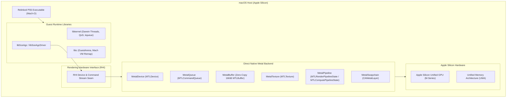
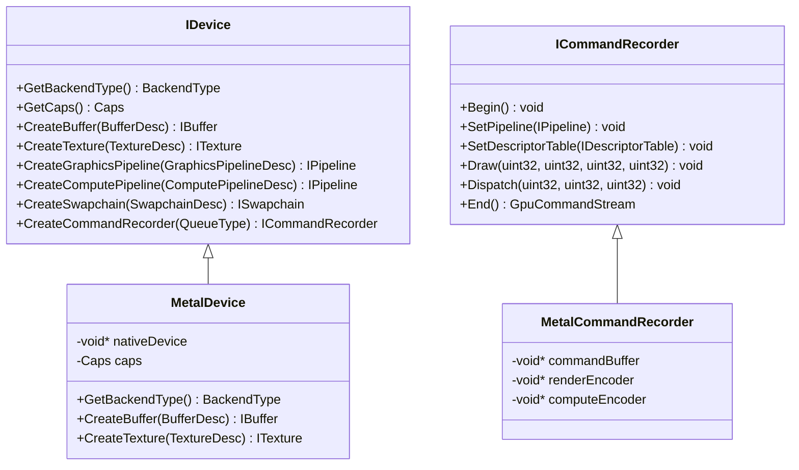
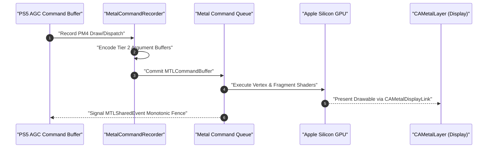
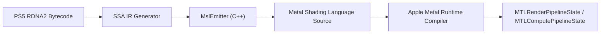

# AnyPS5 macOS Architecture & Metal Graphics Subsystem

This document provides a comprehensive technical reference for the native macOS port and Apple Metal graphics backend of AnyPS5.

---

## 1. Architectural Overview & Design Principles

AnyPS5 relinks PlayStation 5 ELF executables and dynamic libraries into native Mach-O binaries that execute directly against reimplemented runtime libraries on macOS.



### Core Principles
- **Direct Native Architecture**: Zero translation shims, zero MoltenVK, and zero intermediate API overhead. All PS5 GPU concepts map directly to Apple Metal framework objects.
- **Fail-Fast Policy**: Any unsupported API, PM4 packet, or feature immediately throws an exception or calls `NotImplemented_nid_no_patch(__func__)` rather than silently continuing with incorrect state.
- **Zero-Copy Unified Memory**: Leverages Apple Silicon's Unified Memory Architecture (UMA) for instant CPU-GPU memory sharing without PCIe staging buffers.

---

## 2. CPU Execution & Memory Model

### 2.1 CPU Execution via Rosetta 2
- PlayStation 5 uses AMD Zen 2 x86_64 CPU cores with AVX2 and FMA extensions.
- On Apple Silicon, relinked x86_64 Mach-O executables run under Apple Rosetta 2 JIT translation.
- Rosetta 2 provides native hardware-assisted AVX and AVX2 translation on macOS 14+, running full-speed without instruction emulation loops.

### 2.2 2 TiB Virtual Memory Arena (`GuestArena`)
- PS5 games utilize a 48-bit virtual address space.
- AnyPS5 reserves a contiguous 2 TiB virtual memory space at startup via Mach VM APIs:
  ```c
  mach_vm_allocate(mach_task_self(), &guestBase, 0x20000000000ULL, VM_FLAGS_ANYWHERE);
  ```
- Memory is committed on-demand with 16 KiB APFS page granularity.

### 2.3 `mach_vm_remap` Zero-Copy Aliasing
- PS5 GPU memory architecture maps host memory directly to GPU-visible VRAM/GART spaces.
- On macOS, zero-copy aliasing is achieved using Mach virtual memory remapping:
  ```c
  mach_vm_remap(mach_task_self(), &targetAddr, size, 0, VM_FLAGS_FIXED | VM_FLAGS_OVERWRITE,
                mach_task_self(), sourceAddr, FALSE, &curProt, &maxProt, VM_INHERIT_NONE);
  ```

### 2.4 Write-Watch via Mach Exception Ports
- PS5 games use write-watch tracking for GPU buffer synchronization and dirtied memory pages.
- AnyPS5 installs a dedicated Mach exception handler (`EXC_BAD_ACCESS`) via MIG (`mach_excServer.c`).
- When the guest writes to protected pages, the exception thread logs the write, restores write permissions via `mach_vm_protect`, and resumes thread execution transparently.

---

## 3. Rendering Hardware Interface (RHI)

The RHI (`core/gpu/rhi/`) decouples `libSceAgcDriver` from graphics API specifics, enabling AnyPS5 to support Vulkan (Linux/Windows) and Metal (macOS) interchangeably.



---

## 4. Native Metal Graphics Backend (`core/gpu/metal/`)

### 4.1 Resource Management
- **Zero-Copy Buffers**: `MetalBuffer` wraps guest allocations using `newBufferWithBytesNoCopy:length:options:deallocator:` with `MTLResourceStorageModeShared`. Because host CPU and Apple GPU share unified RAM, uploads are zero-copy.
- **Pixel Formats**: Direct 1:1 mapping from PS5 formats (`kFormatR8G8B8A8Unorm`, `kFormatD32FloatS8Uint`, etc.) to Metal equivalents (`MTLPixelFormatRGBA8Unorm`, `MTLPixelFormatDepth32Float_Stencil8`).
- **Tier 2 Argument Buffers**: Emulates PS5 indirect descriptor tables through Tier 2 argument buffers (`MTLArgumentEncoder`), providing unbounded descriptor capacity per draw call.

### 4.2 Synchronization
- Monotonic synchronization uses `MTLSharedEvent`.
- CPU-GPU timeline fences advance monotonically:
  ```objc
  [commandBuffer encodeSignalEvent:sharedEvent value:signalValue];
  ```
- CPU threads wait via `[sharedEvent waitUntilSignaledValue:value timeoutMS:timeout]`.

### 4.3 Swapchain & Presentation
- Presenting surfaces are bound to `CAMetalLayer` instances.
- Double/triple buffering uses `[metalLayer nextDrawable]`.
- Frame pacing is handled via `CAMetalDisplayLink` on a dedicated pacing thread to prevent blocking main UI execution.



---

## 5. Direct RDNA2 to MSL Shader Recompiler

The recompiler (`core/shader/recompiler/MslBackend/`) directly lowers RDNA2 SSA Intermediate Representation (IR) to Metal Shading Language (MSL 3.0/3.1).



### 5.1 Wavefront Translation
- RDNA2 Wave32 mode maps 1:1 to Apple GPU 32-wide `simdgroup`.
- Wave operations translate directly to Metal SIMD intrinsics:
  - `v_readfirstlane_b32` $\rightarrow$ `simd_broadcast_first(val)`
  - `v_readlane_b32` $\rightarrow$ `simd_shuffle(val, laneId)`
  - `s_barrier` $\rightarrow$ `threadgroup_barrier(mem_flags::mem_device | mem_flags::mem_threadgroup)`

### 5.2 Resource Binding Model
- Shaders receive an `ArgumentTable` containing pointers and descriptors:
  ```metal
  struct ArgumentTable {
      constant uint* buffers[32];
      texture2d<float> textures[128];
      sampler samplers[16];
  };

  kernel void main0(
      uint3 thread_pos [[thread_position_in_grid]],
      uint simd_lane [[thread_index_in_simdgroup]],
      constant ArgumentTable& args [[buffer(0)]]
  ) { ... }
  ```
